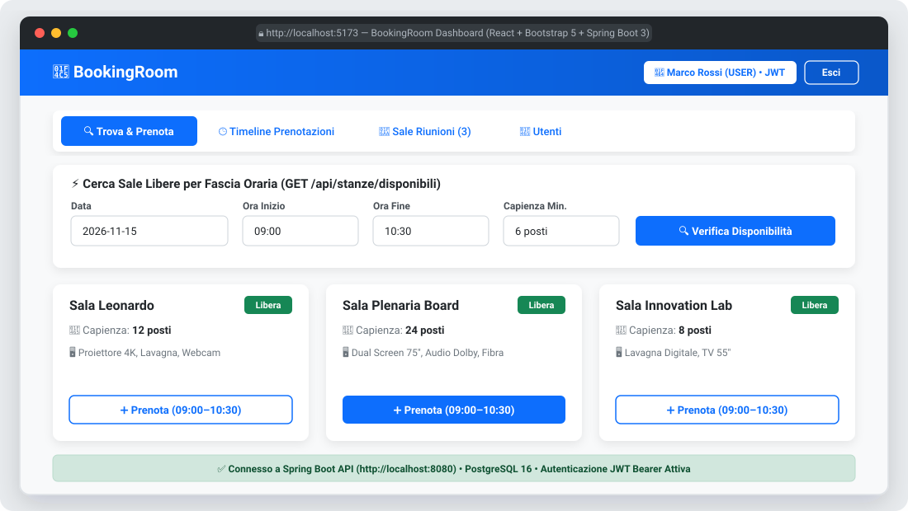

# BookingRoom API


Backend RESTful sviluppato con **Spring Boot 3** e **Java 21** per la gestione completa di sale riunioni, disponibilità orarie, utenti e prenotazioni aziendali, progettato per lavorare in sinergia con la Single Page Application **[BookingRoom Frontend (`bookingRoomFE`)](https://github.com/simonesici/bookingRoomFE)** in **React + Vite + Bootstrap 5**.



---

## Caratteristiche Principali

- **Gestione Sale Riunioni (`Stanza`)**:
  - Anagrafica stanze con **vincolo di unicità** sul nome, **capienza** massima e **descrizione/dotazioni** (es. proiettore, lavagna, videoconferenza).
  - Filtro stanze per capienza minima (`?capienzaMinima=`).
  - **Ricerca disponibilità in tempo reale**: individuazione delle stanze libere in uno specifico intervallo `[dataI, dataF)` con filtro opzionale sulla capienza.
- **Motore di Prenotazione (`Prenotazione`)**:
  - Prevenzione automatica delle sovrapposizioni orarie (`overlap detection`) con supporto agli **slot adiacenti** (es. `09:00–10:00` seguito da `10:00–11:00`).
  - Validazione formale degli intervalli temporali (`dataI < dataF`).
  - Consultazione **timeline** mensile e per anno/mese (`/timeline/{anno}/{mese}`), oltre a filtri per singola stanza o singolo utente.
- **Sicurezza Stateless & JWT**:
  - Autenticazione **JWT Bearer (`HS256`)** e **HTTP Basic** su database (`CustomUserDetailsService`) con fallback sull'utente amministratore di bootstrap.
  - Password cifrate con **BCrypt** (`BCryptPasswordEncoder`) e mai esposte nelle risposte JSON (`WRITE_ONLY`).
  - Supporto ai ruoli utente (`USER`, `ADMIN`) e **CORS** preconfigurato per il frontend React + Vite (`http://localhost:5173`).
- **Qualità Architetturale**:
  - Architettura pulita basata su **DTO** e **Bean Validation** (`jakarta.validation`).
  - Prevenzione del problema *N+1* tramite `@EntityGraph` sui repository JPA.
  - Gestione centralizzata degli errori tramite `@RestControllerAdvice` (`GlobalExceptionHandler`) con risposte JSON strutturate (`400`, `401`, `404`, `409`).
  - Documentazione interattiva **OpenAPI 3 / Swagger UI** con supporto diretto a **Authorize (Bearer JWT)**.

---

## Stack Tecnologico

| Componente | Tecnologia |
| :--- | :--- |
| **Linguaggio** | Java 21 |
| **Framework** | Spring Boot 3.2.5 (Web, Data JPA, Validation, Security) |
| **Database (Runtime)** | PostgreSQL 16 |
| **Database (Test)** | H2 In-Memory |
| **Autenticazione** | JWT Stateless (`HS256`) + HTTP Basic + BCrypt |
| **API Docs** | SpringDoc OpenAPI 2.5.0 (Swagger UI) |
| **Containerizzazione** | Docker & Docker Compose |
| **Build Tool** | Maven Wrapper (`./mvnw`) |

---

## Avvio Rapido

### Opzione 1 — Con Docker Compose *(Consigliata)*

Avvia automaticamente sia il database **PostgreSQL 16** sia l'applicazione **Spring Boot**:

```bash
docker compose up --build -d
```

L'applicazione sarà disponibile su `http://localhost:8080`.

### Opzione 2 — Esecuzione Locale con Maven

1. Assicurati di avere un'istanza PostgreSQL attiva su `localhost:5432` con database `booking_db` (oppure imposta le variabili d'ambiente `SPRING_DATASOURCE_URL`, `SPRING_DATASOURCE_USERNAME`, `SPRING_DATASOURCE_PASSWORD`).
2. Avvia il progetto tramite Maven Wrapper:

```bash
./mvnw spring-boot:run
```

---

## Documentazione Interattiva (Swagger UI)

Una volta avviata l'applicazione, puoi esplorare e testare tutte le API direttamente dal browser:

- **Swagger UI**: [http://localhost:8080/swagger-ui/index.html](http://localhost:8080/swagger-ui/index.html)
- **OpenAPI JSON**: [http://localhost:8080/v3/api-docs](http://localhost:8080/v3/api-docs)

> **Suggerimento**: Esegui `POST /api/auth/login` per ottenere il tuo token JWT, poi clicca sul pulsante **Authorize** in alto a destra su Swagger UI e incolla il token per autenticare tutte le chiamate di scrittura.

---

## Autenticazione e Sicurezza

### Regole di Accesso
- **Endpoint Pubblici (`permitAll`)**:
  - `POST /api/auth/login`
  - Tutte le chiamate di sola lettura `GET /api/stanze/**` e `GET /api/prenotazioni/**`
  - Swagger UI (`/swagger-ui/**`, `/v3/api-docs/**`)
- **Endpoint Protetti (`authenticated`)**:
  - `GET /api/auth/me`
  - Tutte le operazioni su `/api/utenti/**`
  - Tutte le operazioni di creazione, modifica e cancellazione (`POST`, `PUT`, `DELETE`) su `/api/stanze/**` e `/api/prenotazioni/**`

### Esempio di Login JWT

**Richiesta (`POST /api/auth/login`)**:
```json
{
  "email": "admin",
  "password": "admin"
}
```
*(Puoi effettuare il login sia con l'`email` o il `name` di qualsiasi utente registrato a database, sia con l'utente di bootstrap `admin`/`admin`).*

**Risposta (`200 OK`)**:
```json
{
  "token": "eyJhbGciOiJIUzI1NiIsInR5cCI6IkpXVCJ9...",
  "tokenType": "Bearer",
  "expiresIn": 86400,
  "username": "admin",
  "role": "ROLE_USER"
}
```

Usa il token nelle chiamate successive tramite l'header HTTP:
```http
Authorization: Bearer <token>
```

---

## Riferimento Endpoint API

### Autenticazione (`/api/auth`)
| Metodo | Endpoint | Descrizione | Auth |
| :--- | :--- | :--- | :---: |
| `POST` | `/api/auth/login` | Autentica un utente e restituisce il token JWT Bearer | Pubblico |
| `GET` | `/api/auth/me` | Restituisce il profilo e i ruoli dell'utente corrente | Protetto |

### Utenti (`/api/utenti`)
| Metodo | Endpoint | Descrizione | Auth |
| :--- | :--- | :--- | :---: |
| `POST` | `/api/utenti` | Crea un nuovo utente (password cifrata con BCrypt, email univoca) | Protetto |
| `GET` | `/api/utenti` | Elenca tutti gli utenti registrati | Protetto |
| `GET` | `/api/utenti/{id}` | Recupera i dettagli di un utente per ID | Protetto |
| `PUT` | `/api/utenti/{id}` | Aggiorna i dati di un utente esistente | Protetto |
| `DELETE` | `/api/utenti/{id}` | Elimina un utente per ID | Protetto |

### Stanze (`/api/stanze`)
| Metodo | Endpoint | Descrizione | Auth |
| :--- | :--- | :--- | :---: |
| `GET` | `/api/stanze` | Elenca tutte le stanze (supporta `?capienzaMinima=`) | Pubblico |
| `GET` | `/api/stanze/disponibili` | Cerca le stanze libere nel periodo (`?dataI=...&dataF=...&capienzaMinima=`) | Pubblico |
| `GET` | `/api/stanze/{id}` | Recupera una stanza per ID | Pubblico |
| `POST` | `/api/stanze` | Crea una nuova stanza (`nome`, `capienza`, `descrizione`) | Protetto |
| `PUT` | `/api/stanze/{id}` | Aggiorna una stanza esistente | Protetto |
| `DELETE` | `/api/stanze/{id}` | Elimina una stanza | Protetto |

### Prenotazioni (`/api/prenotazioni`)
| Metodo | Endpoint | Descrizione | Auth |
| :--- | :--- | :--- | :---: |
| `GET` | `/api/prenotazioni` | Elenca tutte le prenotazioni | Pubblico |
| `GET` | `/api/prenotazioni/{id}` | Recupera una prenotazione per ID | Pubblico |
| `GET` | `/api/prenotazioni/timeline/{mese}` | Filtra le prenotazioni per mese (`1..12`) | Pubblico |
| `GET` | `/api/prenotazioni/timeline/{anno}/{mese}` | Filtra le prenotazioni per anno e mese | Pubblico |
| `GET` | `/api/prenotazioni/stanza/{stanzaId}` | Storico prenotazioni di una specifica stanza | Pubblico |
| `GET` | `/api/prenotazioni/utente/{utenteId}` | Storico prenotazioni di uno specifico utente | Pubblico |
| `POST` | `/api/prenotazioni` | Crea una nuova prenotazione verificando conflitti orari | Protetto |
| `PUT` | `/api/prenotazioni/{id}` | Aggiorna una prenotazione esistente | Protetto |
| `DELETE` | `/api/prenotazioni/{id}` | Cancella una prenotazione | Protetto |

---

## Struttura del Progetto

```text
src/main/java/it/roombooking/booking/
├── BookingApplication.java          # Entry point Spring Boot (Timezone Europe/Rome)
├── config/
│   ├── OpenApiConfig.java           # Configurazione Swagger UI con JWT Bearer Auth
│   └── WebSecConfig.java            # Regole Spring Security Stateless & PasswordEncoder
├── controller/
│   ├── AuthCtrl.java                # Endpoint /api/auth (login, me)
│   ├── PrenotazioneCtrl.java        # Endpoint /api/prenotazioni
│   ├── StanzaCtrl.java              # Endpoint /api/stanze
│   └── UtenteCtrl.java              # Endpoint /api/utenti
├── dto/                             # Data Transfer Objects & Validazioni Jakarta
├── exception/                       # GlobalExceptionHandler (@RestControllerAdvice) & Eccezioni custom
├── model/                           # Entità JPA (Utente, Stanza, Prenotazione)
├── repository/                      # Interfacce Spring Data JPA con @EntityGraph
├── security/                        # JwtService, JwtAuthenticationFilter, CustomUserDetailsService
└── service/                         # Logica di business transazionale (UtenteDAO, StanzaDAO, PrenotazioneDAO)
```

---

## Test

I test di integrazione utilizzano un database **H2 in-memory** isolato e verificano autenticazione JWT/Basic, cifratura password, vincoli di unicità (`409 Conflict`), validazione date/slot adiacenti, ricerca disponibilità stanze e filtri timeline:

```bash
./mvnw test
```

---

## Configurazione (`Variables & Properties`)

Le principali proprietà configurabili (tramite `application.properties` o variabili d'ambiente):

| Variabile d'Ambiente | Property Spring | Default |
| :--- | :--- | :--- |
| `SPRING_DATASOURCE_URL` | `spring.datasource.url` | `jdbc:postgresql://localhost:5432/booking_db` |
| `SPRING_DATASOURCE_USERNAME` | `spring.datasource.username` | `postgres` |
| `SPRING_DATASOURCE_PASSWORD` | `spring.datasource.password` | `postgres` |
| `APP_JWT_SECRET` | `app.jwt.secret` | `bookingroom-super-secret-jwt-key-2026-hs256-secure` |
| `APP_JWT_EXPIRATION_SECONDS` | `app.jwt.expiration-seconds` | `86400` (24h) |
